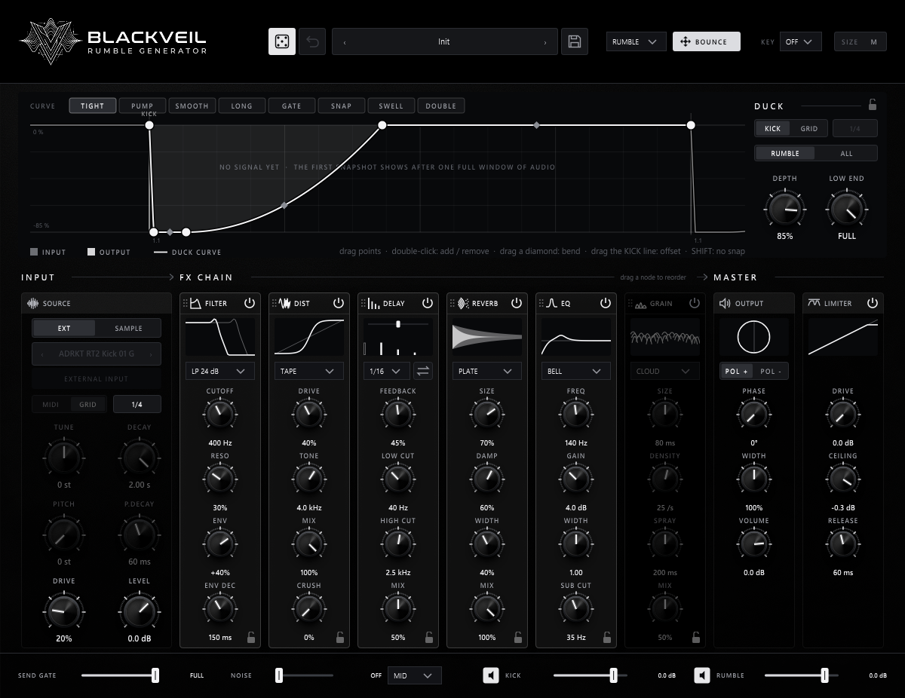

# Blackveil

**A techno rumble generator, by ShadowDSP.** Free and open source (GPL-3.0), VST3 for Windows.

Blackveil is built for one job: the techno rumble. Kick in, rumble out, already ducked, in key and
mix-ready, without a send, a reverb chain and a sidechain compressor to set up. And when you want
more than a preset, every stage is yours to shape, for precise rumble design.

[**Download the latest version**](https://github.com/zvectormusic/blackveil/releases/latest) ·
[**User manual**](https://zvectormusic.github.io/blackveil/) ·
[**Sound demos**](https://zvectormusic.github.io/blackveil/blackveil/demos.html) ·
[Manuel en français](https://zvectormusic.github.io/blackveil/fr/blackveil/)

## Highlights

- **Your kick or a built-in one.** Put it on your kick track (EXT) or let it play its own kicks
  (SAMPLE), from MIDI notes or on the host's grid. Drop in your own samples and step through their
  folder.
- **Tuned to your track.** Pick a KEY: the kick is tuned to it, and the EQ and the comb filter
  snap to its notes.
- **A reorderable FX chain.** FILTER (classic and ladder / diode / comb models), DIST (tape, tube,
  fold, clip, plus bit crush), a tempo-synced DELAY with swing and ping-pong, REVERB (plate, hall,
  spring, shimmer, dark), EQ and a GRAIN cloud. Drag the modules into any order.
- **A duck curve you draw.** The visualizer shows the rumble and the curve over one beat: drag
  points, bend segments, slide the offset. Ten curve presets, from TIGHT and PUMP to the
  rhythmic CHOP and SHUFFLE. Duck only the low end, or the whole output.
- **Mix-ready output.** Phase, polarity and width for the rumble, BASS MONO, a SEND GATE to keep
  tails short, NOISE for texture, separate KICK and RUMBLE faders, and a limiter.
- **RANDOM and MUTATE.** Roll a new sound built from recipes that always make a rumble, or nudge
  the current one; lock the modules you want to keep; undo up to eight rolls.
- **A real preset browser.** 22 factory presets plus Init, in categories, search, favourites, and your own
  categories.
- **BOUNCE.** Drag the rumble, the kick or the mix straight into your DAW as audio, named with the
  preset, tempo and key.
- **Automatable.** The controls are host parameters your DAW can automate (the duck curve and the
  FX order are saved with the session).

## Requirements

- Windows 10 or 11, 64-bit
- A VST3 host. Blackveil is tested in Ableton Live; it loads as an audio effect that also takes
  MIDI.

## Install

1. Close your DAW.
2. Download `Blackveil-<version>-Setup.exe` from the
   [latest release](https://github.com/zvectormusic/blackveil/releases/latest) and run it. The
   installer isn't signed yet: if Windows shows "Windows protected your PC", click **More info**,
   then **Run anyway**.
3. Start your DAW and let it rescan its plugins.

Or skip the installer: download `Blackveil-<version>-VST3.zip` from the same release, unzip it and
copy the `Blackveil.vst3` folder into `C:\Program Files\Common Files\VST3\`.

New versions install over the old one and keep your presets. Then start with
[Getting started](https://zvectormusic.github.io/blackveil/blackveil/getting-started.html) or the
[tutorial](https://zvectormusic.github.io/blackveil/blackveil/tutorial.html).

## Manual

| | |
|---|---|
| [Getting started](https://zvectormusic.github.io/blackveil/blackveil/getting-started.html) | Installing, first rumble |
| [Tutorial: a rumble from scratch](https://zvectormusic.github.io/blackveil/blackveil/tutorial.html) | A guided build, step by step |
| [Blackveil in your DAW](https://zvectormusic.github.io/blackveil/blackveil/in-your-daw.html) | The four setups, arranging, mixing |
| [FX chain](https://zvectormusic.github.io/blackveil/blackveil/fx-chain.html) | FILTER, DIST, DELAY, REVERB, EQ, GRAIN |
| [Duck and the visualizer](https://zvectormusic.github.io/blackveil/blackveil/duck.html) | The duck curve, its presets, editing it |
| [Presets and RANDOM](https://zvectormusic.github.io/blackveil/blackveil/presets.html) | The browser, saving, RANDOM, locks |
| [BOUNCE](https://zvectormusic.github.io/blackveil/blackveil/bounce.html) | Dragging audio into your DAW |
| [Tips and troubleshooting](https://zvectormusic.github.io/blackveil/blackveil/tips.html) | Recipes, common problems |

## Building from source

Blackveil is a [HISE](https://hise.dev) project (`projects/Blackveil/`), with its DSP in a C++
node (`DspNetworks/ThirdParty/bv_engine.h`). It is built with a locally patched HISE and Visual
Studio 2022: see `CLAUDE.md` for the environment and the build steps (`tools/build_plugin.sh`,
`tools/build_installer.sh`) and `tools/hise-patches/` for the patches.

## Licence

Blackveil is free software under the [GNU General Public License v3](LICENSE). It includes
GPL-3.0 code from Vital (filters, a reverb), DuskVerb (reverb rooms), HISE and JUCE; the
notices are in [`projects/Blackveil/installer/THIRD-PARTY.txt`](projects/Blackveil/installer/THIRD-PARTY.txt).

Bug reports and ideas: [open an issue](https://github.com/zvectormusic/blackveil/issues).
